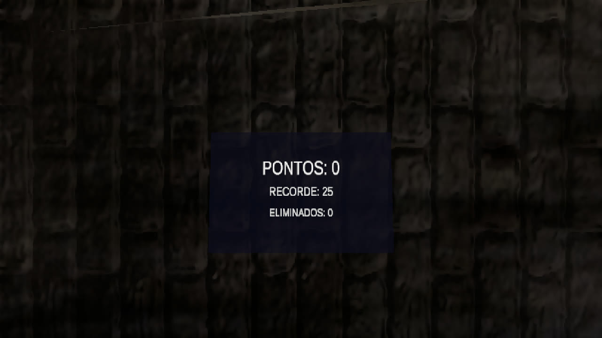
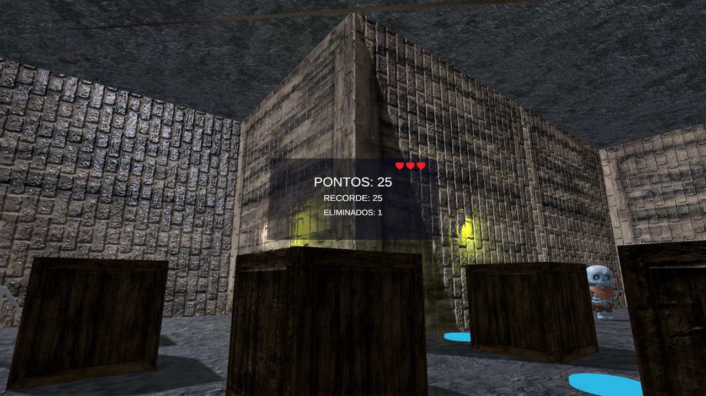
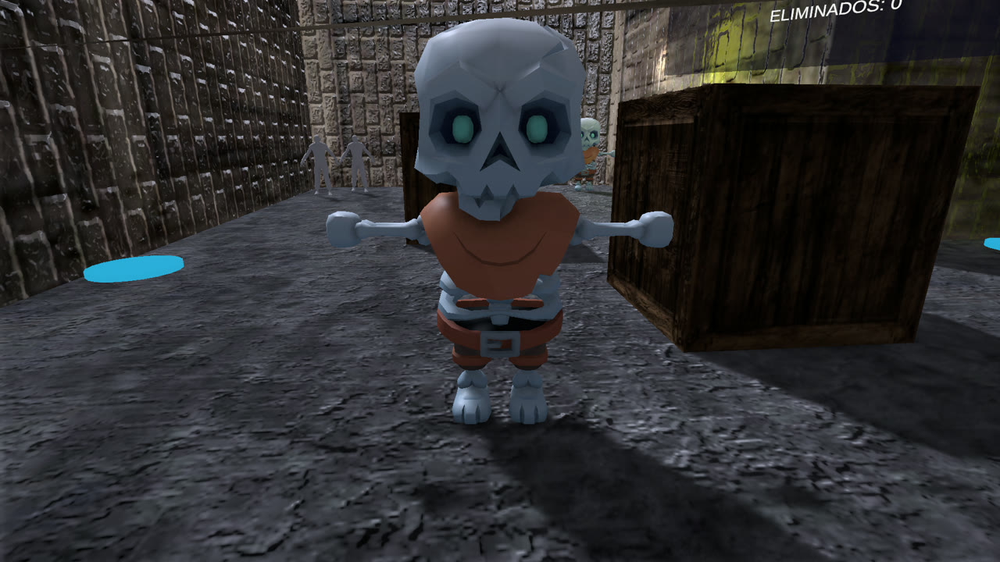

# Zombie VR Shooter

Um jogo de tiro em VR para Android, feito com Unity e Google Cardboard. O
jogador fica parado, olha ao redor com o giroscópio do celular e elimina zumbis
mirando na cabeça. Não é necessário controle.

[Baixar o APK mais recente](https://github.com/brunomouramathias/zombie-vr-shooter/releases/latest)



| HUD | Inimigo |
| --- | --- |
|  |  |

## Funcionalidades

- Renderização estereoscópica em VR com Google Cardboard (rastreamento 3DoF).
- Tiro por olhar: a arma dispara automaticamente quando a mira está na cabeça
  de um inimigo.
- Dois tipos de inimigos com pathfinding por NavMesh, animações de caminhada,
  ataque e morte, além de áudio 3D.
- Spawner com distância, atraso e dificuldade configuráveis.
- HUD em world space com pontuação, recorde e barra de vida com três corações.
- Fim de jogo por contato com inimigo, com reinício por olhar ou pelo trigger do
  Cardboard.
- Sistema opcional de navegação por waypoints para o jogador.
- Testes PlayMode cobrindo o fluxo principal do jogo.

## Stack

| Camada | Tecnologia |
| --- | --- |
| Engine | Unity 6000.5.9f1 |
| Renderização | Universal Render Pipeline (URP) |
| Linguagem | C# |
| Entrada | Unity Input System |
| VR | XR Plug-in Management + Google Cardboard XR Plugin 1.35.0 |
| IA | Unity AI Navigation (NavMesh) |
| UI | uGUI + TextMesh Pro |
| Plataforma | Android (IL2CPP, arm64) |

## Controles

| Ação | Unity Editor | Android / Cardboard |
| --- | --- | --- |
| Olhar ao redor | Segurar o botão direito do mouse e arrastar | Mover o celular / a cabeça |
| Atirar | Mirar na cabeça de um inimigo | Mirar na cabeça de um inimigo |
| Reiniciar após o fim de jogo | `R`, `Enter` ou `Espaço`, ou olhar para **REINICIAR** | Olhar para **REINICIAR** por 1,5 s ou apertar o trigger do Cardboard |

Os controles do editor servem para testes rápidos. A renderização estéreo e o
rastreamento pelo giroscópio só funcionam em um dispositivo Android compatível.

## Como executar

Requisitos:

- Unity Hub e Unity **6000.5.9f1**.
- Android Build Support (SDK, NDK e OpenJDK) para gerar o APK.

Passos:

1. Clone o repositório.
2. No Unity Hub, escolha **Add project from disk** e selecione a pasta do
   projeto.
3. Abra `Assets/Scenes/Zombie.unity`.
4. Aperte **Play**.

O plugin do Cardboard está incluído em `Packages/com.google.xr.cardboard`, então
não é necessário baixar nada pelo Git. O Unity ainda vai restaurar os demais
pacotes do registro na primeira abertura.

## Como gerar o APK Android

1. Abra **File > Build Settings**.
2. Selecione **Android** e clique em **Switch Platform**.
3. Confirme que `Assets/Scenes/Zombie.unity` é a única cena habilitada.
4. Clique em **Build** e escolha o caminho de saída.

Também é possível usar **Tools > Zombie VR > Build APK**. O build é gerado em
`Builds/ZombieVR.apk` dentro do projeto.

Configurações usadas pelo projeto:

- Application ID: `com.brunomouramathias.zombievr`
- Nível mínimo de API: 26 (Android 8.0)
- Arquitetura: ARM64
- Backend de scripts: IL2CPP

## Estrutura do projeto

```
Assets/
  Editor/          Ferramentas de editor (setup da cena e build do APK)
  Resources/       Prefabs de inimigos, bala e áudio carregados em runtime
  Scenes/          Zombie.unity (cena principal)
  Scripts/         Scripts de gameplay, IA, UI e VR
  Tests/PlayMode/  Testes PlayMode
Packages/          Manifesto do Unity e plugin Cardboard embutido
ProjectSettings/   Configurações de build, XR, gráficos e entrada
docs/              Documentação de arquitetura e capturas de tela
```

## Como funciona

- `VrBootstrapper` garante que o XR inicie no Android mesmo se a inicialização
  do XR Management atrasar.
- `PlayerController` cuida da detecção de olhar e da câmera no editor. A raiz do
  jogador fica fixa, então a experiência funciona em pé, sem deslocamento.
- `WeaponController` faz um raycast a partir da câmera e dispara quando o ponto
  atingido está na cabeça de um inimigo. Os tiros causam dano e somam pontos.
- `ZombieController` controla o NavMeshAgent, o estado das animações e o áudio
  de cada inimigo. Também trata ataque, knockback e morte.
- `EnemySpawner` começa cada rodada com um pequeno atraso, posiciona inimigos em
  pontos válidos da NavMesh longe do jogador e aumenta a onda conforme a
  pontuação.
- `ScoreboardUI` desenha o HUD em world space, atualiza os corações e mostra o
  painel de fim de jogo.
- `GameManager` mantém o estado do jogo, a pontuação, o recorde e as vidas.

Mais detalhes estão em [docs/architecture.md](docs/architecture.md).

## Testes

O projeto inclui testes PlayMode em
`Assets/Tests/PlayMode/ZombieVRPlayModeTests.cs`.

Para executar:

1. Abra **Window > General > Test Runner**.
2. Selecione **PlayMode**.
3. Clique em **Run All**.

## Créditos

- Google Cardboard XR Plugin for Unity, licença Apache 2.0.
- Assets de inimigos, arma e cenário: veja `Assets/Enemy/CREDITS.md`.
- Áudio: veja `Assets/Sons/CREDITS.md`.
- Avisos de terceiros: [THIRD_PARTY_NOTICES.md](THIRD_PARTY_NOTICES.md).

## Licença

Este projeto está sob a licença MIT. Veja [LICENSE](LICENSE).
