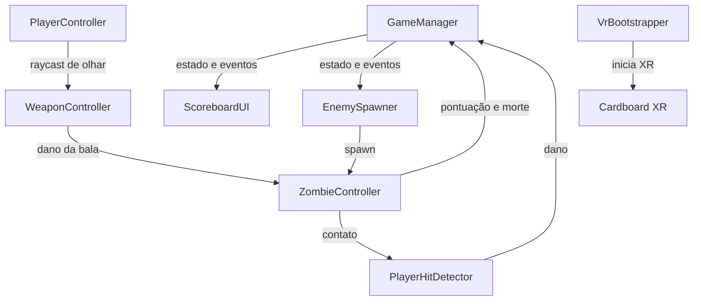

# Arquitetura

## Visão geral

O jogo é uma experiência VR de cena única. Todos os sistemas de gameplay ficam
em `Assets/Scenes/Zombie.unity`; as únicas dependências carregadas por nome em
runtime são os prefabs de inimigos, bala e áudio em `Assets/Resources`.

## Sistemas principais

### Estado do jogo

`GameManager` é um singleton com três estados: `StartMenu`, `Playing` e
`GameOver`. Ele controla a pontuação, o recorde e as vidas atuais, e dispara
eventos consumidos pelo HUD e pelo spawner. O `ScoreboardUI` inicia uma rodada
assim que a cena está pronta, então não existe uma tela de início separada no
build atual.

### Jogador e tiro

`PlayerController` fica na câmera principal. Ele faz um raycast para frente a
cada frame para encontrar alvos de olhar e mantém a raiz do jogador parada. No
editor, também permite olhar com o botão direito do mouse; no dispositivo, o
subsistema de entrada do Cardboard controla a câmera por meio de um
`TrackedPoseDriver` configurado apenas para rotação (3DoF).

`WeaponController` é adicionado à câmera em runtime. Quando o raio de olhar
atinge a cabeça de um inimigo, ele dispara uma bala, aplica dano e soma pontos.
O teste de cabeça usa o nome do osso atingido quando disponível; caso contrário,
compara a altura do impacto com a caixa delimitadora do inimigo.

### Inimigos

`ZombieController` controla um `NavMeshAgent`, um componente de animação e um
`AudioSource` 3D. Ele atualiza o destino quando o jogador se move e reproduz as
animações de caminhada, ataque e morte. Ao morrer, desativa os colliders, soma
pontos e avisa o spawner.

`EnemySpawner` espera um pequeno atraso depois do início da rodada, gera a onda
inicial e mantém a arena populada. Os pontos de spawn são amostrados na NavMesh
a uma distância mínima do jogador, e o tamanho da onda cresce com a pontuação
até um limite fixo.

### HUD

`ScoreboardUI` usa um canvas em world space que acompanha a câmera com um
deslocamento suave e restrito na vertical. Ele mostra pontuação, recorde e três
corações, e troca para o painel de fim de jogo quando o jogador perde todas as
vidas. O botão de reinício aceita olhar com dwell, trigger do Cardboard, toque e
mouse.

### Bootstrap de VR

`VrBootstrapper` é criado automaticamente em runtime no Android. Ele verifica o
estado do XR depois da inicialização e, se necessário, inicializa o loader do
Cardboard pelo XR Management ou diretamente pelo asset do loader embutido. Isso
cobre dispositivos em que o início automático do XR é lento ou bloqueado.

## Configuração de XR

- O XR Plug-in Management está habilitado para o build target Android.
- O loader do Cardboard é referenciado em
  `Assets/XR/XRGeneralSettingsPerBuildTarget.asset`.
- O asset do loader fica em `Assets/Resources/XR/XRLoader.asset` para que o
  bootstrap consiga carregá-lo diretamente se precisar.
- O `TrackedPoseDriver` usa rastreamento `RotationOnly`, porque o Cardboard
  fornece orientação, não posição.

## Fluxo de dados

1. A rodada começa e o `EnemySpawner` gera a primeira onda.
2. Os inimigos se movem até o jogador usando a NavMesh.
3. O jogador olha para a cabeça de um inimigo; o `WeaponController` dispara e o
   `ZombieController` recebe dano.
4. Um inimigo morto soma pontos e é removido da lista do spawner.
5. Um inimigo que alcança o jogador aciona o `PlayerHitDetector`, que remove uma
   vida.
6. Com zero vidas, o estado muda para `GameOver` e o HUD mostra o painel de
   reinício.
