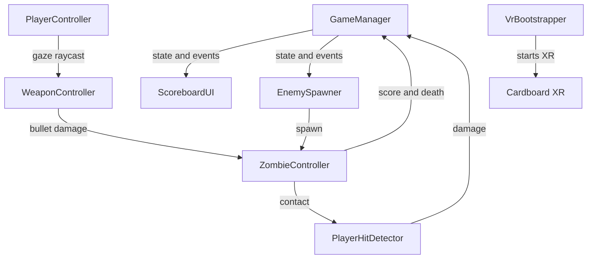

# Architecture

## Overview

The game is a single-scene VR experience. All gameplay systems live in
`Assets/Scenes/Zombie.unity`; the only runtime dependencies loaded by name are
the enemy, bullet and audio prefabs in `Assets/Resources`.

## Core systems

### Game state

`GameManager` is a singleton with three states: `StartMenu`, `Playing` and
`GameOver`. It owns the score, best score and current lives, and raises events
consumed by the HUD and the spawner. `ScoreboardUI` starts a round as soon as
the scene is ready, so there is no separate start screen in the current build.

### Player and shooting

`PlayerController` sits on the main camera. It raycasts forward every frame to
find gaze targets and keeps the player root stationary. In the editor it also
allows right-mouse look; in a device build the Cardboard input subsystem drives
the camera through a `TrackedPoseDriver` configured for rotation only (3DoF).

`WeaponController` is added to the camera at runtime. When the gaze ray hits an
enemy's head, it fires a bullet, applies damage and awards points. The head test
uses the hit bone name when available; otherwise it compares the hit height with
the enemy's bounding box.

### Enemies

`ZombieController` controls a `NavMeshAgent`, an animation component and a 3D
`AudioSource`. It updates its destination when the player moves and plays walk,
attack and death animations. On death it disables its colliders, adds score and
notifies the spawner.

`EnemySpawner` waits a short delay after the round starts, spawns the initial
wave and then keeps the arena populated. Spawn points are sampled from the
NavMesh at a minimum distance from the player, and the wave size grows with the
score up to a fixed limit.

### HUD

`ScoreboardUI` uses a world-space canvas that follows the camera with a smooth
vertical-constrained offset. It shows score, best score and three hearts, and
switches to a game-over panel when the player loses all lives. The restart
button supports gaze dwell, Cardboard trigger, touch and mouse input.

### VR bootstrap

`VrBootstrapper` is created automatically at runtime on Android. It checks the
XR state after startup and, if necessary, initializes the Cardboard loader
through XR Management or directly through the embedded loader asset. This covers
devices where the automatic XR startup is slow or blocked.

## XR configuration

- XR Plug-in Management is enabled for the Android build target.
- The Cardboard loader is referenced by `Assets/XR/XRGeneralSettingsPerBuildTarget.asset`.
- The loader asset is stored in `Assets/Resources/XR/XRLoader.asset` so the
  bootstrap can load it directly if needed.
- `TrackedPoseDriver` uses `RotationOnly` tracking because Cardboard provides
  orientation, not positional, tracking.

## Data flow

1. A round starts and `EnemySpawner` spawns the first wave.
2. Enemies path to the player using the NavMesh.
3. The player looks at an enemy head; `WeaponController` fires and
   `ZombieController` takes damage.
4. A dead enemy awards score and is removed from the spawner's list.
5. An enemy that reaches the player triggers `PlayerHitDetector`, which removes
   a life.
6. At zero lives the game state changes to `GameOver` and the HUD shows the
   restart panel.
